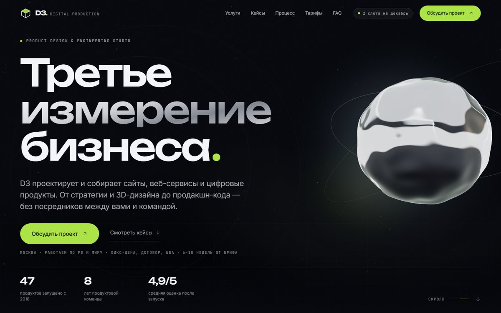

# D3 — студия разработки сайтов и сервисов

Премиальный одностраничный сайт digital-студии **D3** («третье измерение бизнеса»).
Тёмная кинематографичная тема, жидкий хром в WebGL, один кислотный акцент, GSAP-пин проектов,
форма без бэкенда. Весь контент — в одном файле, вся палитра — в одном файле.

В портфолио — реальные проекты: **АСКО PLUS / Asko Support** (отзывы и поддержка сети АЗС+ЭЗС),
**ШАХ LOUNGE** (сайт кальянной и кофейни, реальные скриншоты в карточке),
**E13-CHARGE** (платёжный микросервис на ЮKassa). Карточки сайтов кликабельны и ведут
на живые проекты.



**Живая версия:** https://shah-hookah-bar.ru/d3/ (static export на общем nginx,
рядом с сайтом «Шах», без Node-процесса).
**Локально:** http://localhost:4310 после запуска.

---

## 1. Быстрый старт

```bash
cd studio/d3
npm install
npm run dev -- -p 4310          # разработка → http://localhost:4310
npm run build                   # прод-сборка
npm run start -- -p 4310        # прод-сервер на 4310
```

Требуется Node 24 (проверено на v24.19.0). Шрифты **самохостятся** через
`@fontsource-variable` (`Inter`, `Unbounded`, `JetBrains Mono`, кириллица включена) —
внешний Google Fonts CDN не нужен, сборка не зависит от сети.

Проверка сборки и визуальное QA (сервер должен быть запущен на :4310):

```bash
# типы
npx tsc --noEmit

# скриншоты desktop 1440×900, mobile 390×844 и 390×664, reduced-motion,
# плюс проверки HTTP 200 / overflow / видимости CTA / консольных ошибок
tools\venv-pw\Scripts\python.exe studio\d3\scripts\capture.py

# OG-превью 1200×630 из живого hero
tools\venv-pw\Scripts\python.exe studio\d3\scripts\og.py

# вес JS/CSS по маршрутам (raw + gzip)
python studio\d3\scripts\report-size.py http://127.0.0.1:4310
```

Отчёт по последнему прогону: `studio/screens/d3-qa-report.json`,
скриншоты — `studio/screens/d3-*.png`.

---

## 2. Структура

```
src/
  app/
    layout.tsx            шрифты, metadata, OG, глобальные слои
    template.tsx          page-transition (0.5s, без блокировки навигации)
    page.tsx              композиция секций — единственное место сборки страницы
    globals.css           ВСЕ токены, утилиты, keyframes, reduced-motion
  components/
    providers/
      SmoothScroll.tsx    Lenis + синхронизация с GSAP ScrollTrigger
      MotionProvider.tsx  MotionConfig reducedMotion="user" (один на документ)
    three/
      HeroStage.tsx       ленивая загрузка WebGL + статичный постер-фолбэк
      HeroScene.tsx       three.js: жидкий хром, орбиты, пыль, parallax
    chrome/               SiteNav (+мобильное меню), SiteFooter, CursorGlow,
                          GrainOverlay, ScrollProgress
    ui/                   MagneticButton, Reveal/Stagger, Counter, Marquee,
                          TiltCard, SectionHeading, Logo, icons
    sections/             Hero, ProofMarquee, Manifesto, Services, WorkPinned,
                          ProcessSection, StackSection, Testimonials, Pricing,
                          Faq, Contact
    sections/work/CaseVisual.tsx   5 DOM/SVG-мокапов кейсов (без стоковых фото)
    forms/LeadForm.tsx    форма заявки: клиентская валидация, состояние отправки
  content/site.ts          ВЕСЬ текст и цифры сайта
  lib/motion.ts           EASE / DUR / STAGGER / GSAP_EASE / MQ
public/
  og.jpg                  1200×630 соц-превью (генерируется scripts/og.py)
  icon.svg                изометрический знак D3
  noise.png               плёночное зерно
scripts/
  capture.py              Playwright QA + скриншоты
  og.py                   генерация OG-картинки
  report-size.py          отчёт о весе бандлов
```

---

## 3. Как менять контент

Всё, что читает заказчик, — `src/content/site.ts`:

| Ключ | Что задаёт |
|---|---|
| `hero` | H1 (3 строки), лид, CTA, наличие слотов, 3 мета-факта, 3 KPI |
| `proof` | 4 реальных проекта и их типографический стиль |
| `manifesto` | заголовок, 2 абзаца, 3 принципа, 3 метрики |
| `services` | 5 услуг: цена, срок, теги, иконка, ширина карточки |
| `work` | 3 реальных проекта: отрасль, год, результат, тип визуала, ссылка на сайт |
| `process` | 4 этапа с длительностью и артефактами |
| `stack` | 3 группы технологий |
| `testimonials` | 3 результата проектов (без выдуманных отзывов) |
| `pricing` | 3 тарифа + 3 доп. услуги + примечание |
| `faq` | 6 вопросов |
| `contact` | тексты формы, варианты бюджета, контакты |
| `footer` | колонки и юридическая строка |

Поменяли строку — поменялась вёрстка. JSX трогать не нужно.

**Перекрасить под другой бренд:** в `src/app/globals.css` заменить `--bg`, `--fg`,
`--accent`, `--accent-ink` (опционально `--chrome-*`), и `--font-*` стеки. Компоненты
не содержат hex-значений — только семантические классы (`bg-bg`, `text-muted`,
`border-line`, `bg-accent` и т.д.).

---

## 4. 3D: как это устроено и как не убить производительность

`HeroStage` рендерит статичный постер (CSS-градиенты) на сервере, проверяет поддержку
WebGL и только потом подгружает `HeroScene` через `dynamic(..., { ssr: false })`.
Если WebGL недоступен — остаётся постер, LCP не страдает.

- **Один WebGL-контекст на страницу.** Никаких вторых canvas.
- Сфера с displacement: симплекс-шум в вершинах, нормали — конечными разностями.
- Хром — процедурный «фотостудийный» environment в шейдере: полосы света + софтбокс,
  без HDR-файлов и внешних ассетов.
- DPR ограничен формулой `clamp(1, sqrt(2.5M / (w*h)), 2)`, на мобиле меньше сегментов
  и пыли.
- Пауза при уходе из вьюпорта (`IntersectionObserver`) и при `document.hidden`.
- `prefers-reduced-motion` → один статичный кадр, без rAF и слушателей.
- Все geometry/material/texture получают `dispose()`, canvas — `forceContextLoss()`
  при размонтировании.

Настройки «под себя» — константы в начале `HeroScene.tsx`: `ACCENT`, сегменты сферы,
количество пыли, `dprFor`, композиция камеры в `layout()`.

---

## 5. Движение и reduced-motion

- **Lenis** — плавный скролл (`duration: 1.1`, `syncTouch: false`), синхронизирован с
  `ScrollTrigger.update`. При `prefers-reduced-motion` не создаётся вообще.
- **GSAP ScrollTrigger** — единственный пин страницы (`WorkPinned`): горизонтальная
  лента проектов `scrub: 1`, `invalidateOnRefresh`, только на `(min-width: 1024px)` и без
  reduced-motion. На мобиле — нативный `overflow-x-auto` со `snap-x`.
- **motion/react** — entrance/reveal, мобильное меню, аккордеон, форма. Глобально
  `MotionConfig reducedMotion="user"`: transform-анимации отключаются, opacity
  доигрывается, **контент никогда не остаётся скрытым**.
- Все кривые и длительности — `src/lib/motion.ts`, не «на глаз».
- Анимируются только `transform`/`opacity` (прогресс-линии — `scaleX`).

---

## 6. Производительность и бюджеты

| Метрика | Как держим |
|---|---|
| LCP | hero-текст + CSS-постер; WebGL грузится после, `dynamic ssr:false` |
| CLS | шрифты self-hosted с `display: swap`, у изображений есть размеры, анимации не меняют layout |
| INP | нет scroll/resize-обработчиков без `passive`, GSAP `quickTo` для указателя |
| JS | three.js только в hero, `@fontsource` — статические woff2; вес проверяется `report-size.py` |
| Анимации | transform/opacity, пауза вне вьюпорта и во вкладке-фоне |
| Шрифты | 3 семейства, кириллица + латиница, без внешнего CDN |

---

## 7. Доступность

- Один `h1`, порядок заголовков, landmarks `header/nav/main/footer`, skip-link.
- `:focus-visible` — акцентный outline; `outline: none` нигде нет.
- Мобильное меню: `aria-expanded`/`aria-controls`, Escape, возврат фокуса, блокировка скролла.
- Аккордеон FAQ: реальные `<button>` + `aria-expanded`/`aria-controls`.
- Форма: `<label for>`, `aria-invalid`, `aria-describedby`, ошибки текстом, `noValidate`,
  disabled-состояние кнопки, тач-таргеты ≥ 44 px.
- reduced-motion проверяется скриншотом `d3-hero-reduced-motion.png` — контент виден.

---

## 8. Что заменить перед продакшеном

1. `metadataBase`, домен, OG-ссылки в `src/app/layout.tsx`.
2. Политика конфиденциальности / договор / NDA — ссылки в футере ведут на `#`.
3. Подключить форму к реальному API (сейчас валидация + имитация отправки 700 мс):
   заменить `await new Promise(...)` в `LeadForm.tsx` на `fetch` к вашему эндпоинту.
4. Проверить тексты кейсов и цифры (`content/site.ts`): результаты проектов взяты из
   реальной работы, но метрики лучше уточнять по факту.
5. При смене домена перегенерировать OG: `python scripts/og.py`.

---

## 9. Деплой

**Боевой вариант — git на сервере** (рядом с сайтом Шаха, без Node-процесса):
сервер клонирует репозиторий, собирает статику с `basePath=/d3` и публикует в nginx.

```powershell
# разово: клонировать репозиторий на сервер и задеплоить
ssh root@193.188.22.186 "git clone https://github.com/ballasrr/d3-studio.git /var/www/d3-site && bash /var/www/d3-site/deploy/server-deploy.sh shah-hookah-bar.ru"

# обновление после git push
ssh root@193.188.22.186 "bash /var/www/d3-site/deploy/server-deploy.sh"
```

Живой адрес: https://shah-hookah-bar.ru/d3/. Подробности, резервный деплой из архива,
откат и подводные камни с nginx Шаха — в [`deploy/README.md`](deploy/README.md).

Локально/на обычном хостинге:

```bash
npm run build
npm run start -- -p 3000
```

Либо Vercel: подключить `studio/d3` как корень проекта, framework — Next.js.
Никаких переменных окружения не требуется.
